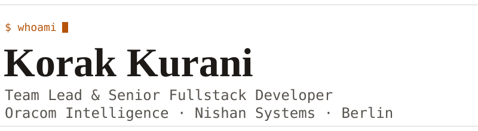

<picture>
  <source media="(prefers-color-scheme: dark)" srcset="assets/banner-dark.svg">
  
</picture>

## Team Lead & Senior Fullstack Developer at Oracom Intelligence · Founder of Nishan Systems

I work on real-time AI conversations and the platform behind them in TypeScript and Nuxt, with a focus on platform engineering: shared tooling, observability, and integrations.
I lead Oracom's IT team of five team members and still write production code. Based in Berlin.

     

<picture>
  <source media="(prefers-color-scheme: dark)" srcset="assets/divider-dark.svg">
  
</picture>

## Case studies

Each one says what I built, led, or designed, and where the claim stops.

- **[Oracom AI platform](https://www.korak-kurani.com/work/oracom-ai-platform/).** Technical direction since the first stack decisions, team leadership, and hands-on engineering.
- **[Real-time AI conversations](https://www.korak-kurani.com/work/realtime-ai-conversations/).** Tracking, cancelling, and cleaning up overlapping generations, and WebSocket connection handling in an avatar app.
- **[Shared tooling and observability](https://www.korak-kurani.com/work/platform-tooling/).** A generated API client shared by several services, and structured logging followed by OpenTelemetry tracing.
- **[Mail automation](https://www.korak-kurani.com/work/mail-automation/).** From incoming mail to templated delivery, including a sending function on AWS Lambda.
- **[All work](https://www.korak-kurani.com/work/)**, including the RAG pipeline I designed and coached a teammate to build, and the infrastructure rebuild in progress.

## Open source

- **[agemon](https://github.com/Korak-997/agemon)** bootstraps an AI coding-agent environment in a repository and cleanly reverses it. TypeScript, MIT, tested, with a dry-run mode. Ubuntu only today.
- **[qrgen](https://github.com/Korak-997/qrgen)** is a free, ad-free QR code generator built with Vue.

## Nishan Systems

A Berlin studio for software, brand, and marketing, founded in September 2026. Morika, a digital loyalty stamp-card product for local merchants in DACH, is in development. [nishansystems.de](https://nishansystems.de)

## Writing

- [Building an AI-Powered Second Brain: Obsidian + Syncthing + Tailscale + Ollama](https://www.korak-kurani.com/writing/building-an-ai-powered-second-brain-obsidian-syncthing-tailscale-ollama/)
- [The Invisible Burn: Why Developer Experience Is Your Biggest Hidden Asset](https://www.korak-kurani.com/writing/the-invisible-burn-why-developer-experience-is-your-biggest-hidden-asset/)
- [The Three-Layer Fortress: Private Cloud with Coolify, Directus and Cloudflare](https://www.korak-kurani.com/writing/the-three-layer-fortress-building-a-private-cloud-with-coolify-directus-and-cloudflare/)

## Connect

- Website: [korak-kurani.com](https://www.korak-kurani.com)
- LinkedIn: [Korak Kurani](https://linkedin.com/in/korak-kurani-94351b235)
